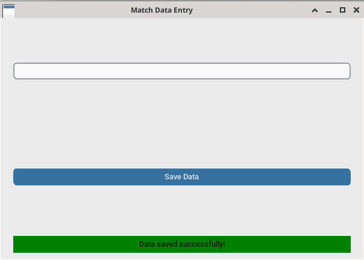
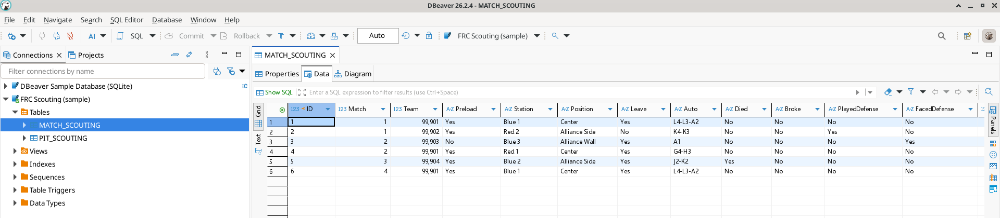
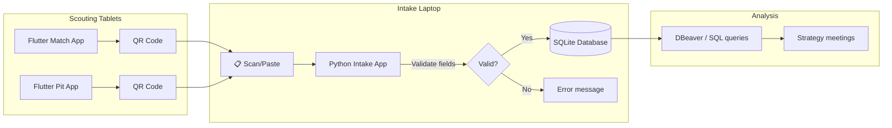

# FRC 2025 Reefscape Scouting Intake & Database

<div align="center">

[](https://www.python.org/)
[](https://github.com/TomSchimansky/CustomTkinter)
[](https://www.sqlite.org/)
[](https://firstfrc.blob.core.windows.net/frc2025/Manual/2025GameManual.pdf)

**Scans scout QR codes from the 2025 Flutter apps into SQLite so strategy questions become SQL queries.**

[Features](#features) · [Screenshots](#screenshots) · [Architecture](#architecture) · [Database Schema](#database-schema) · [Build](#build-instructions)

</div>

---

## Background

Senior year, 2025, I wanted a more professional setup than the QR-into-Excel workflow we'd been using. The Flutter apps still export QR codes—that part works great—but dumping everything into spreadsheets was limiting. This Python/customtkinter intake app scans those QR strings, validates the field count, and inserts directly into SQLite. Now strategy questions are just SQL queries, and DBeaver gives us a real database interface.

I first got into scouting as a freshman in 2022, learning from seniors Heath Crump and Caden Findlay on a [team that reached Einstein](https://www.thebluealliance.com/event/2022cmptx). Sophomore and junior years I built the Android Java match and pit apps myself. QR transfer was never eliminated—it's reliable and offline-first—but the backend finally caught up. This system ran at [Heartland Regional](https://www.thebluealliance.com/event/2025ksla), [Greater Kansas City Regional](https://www.thebluealliance.com/event/2025mokc), and [Houston Championship — Newton Division](https://www.thebluealliance.com/event/2025new).

— [Aamir Abatiyow](https://github.com/AamirAbatiyow)

## Features

- **QR code intake** — Paste the `*`-delimited QR string, validate field count, insert into SQLite
- **Match data entry** (`GKC/match_data_entry.py`) — CustomTkinter GUI for importing match scouting data
- **Pit data entry** (`GKC/pit_data_entry`) — GUI for importing pit scouting information
- **Statbotics integration** (`statbotics_db.py`) — Fetches public team statistics from the [Statbotics API](https://www.statbotics.io/)
- **Offline-first** — No network required during competition; QR codes transfer data between tablets and the intake laptop
- **SQL-queryable** — Strategy questions become `SELECT` statements; export to CSV for alliance selection meetings

## Screenshots

<div align="center">
<table>
  <tr>
    <td align="center"><br/><b>Match Data Entry</b><br/><sub>CustomTkinter intake app after saving a scanned match (sample data, fake team 99901)</sub></td>
    <td align="center"><br/><b>DBeaver Query View</b><br/><sub>MATCH_SCOUTING table with sample data (fake 9990x teams)</sub></td>
  </tr>
</table>
</div>

## Architecture



### Data Flow

1. **Scouts use Flutter apps** on tablets to record match/pit observations
2. **App generates QR code** encoding all fields with `*` delimiters
3. **Scan or paste** the QR string into the intake app's text entry
4. **Validation** — App splits on `*`, checks for exactly 23 fields (match) or 39 fields (pit)
5. **Database insert** — Valid data inserted into SQLite with auto-incrementing ID
6. **Query & analyze** — Use DBeaver or raw SQL for alliance selection and match strategy

## Database Schema

### MATCH_SCOUTING Table

| Column | Type | Description |
|--------|------|-------------|
| ID | INTEGER | Primary key (auto-increment) |
| Match | INTEGER | Match number |
| Team | INTEGER | Team number being scouted |
| Preload | TEXT | Whether robot had preloaded game piece |
| Station | TEXT | Driver station position (e.g., "Blue 1") |
| Position | TEXT | Starting position on field |
| Leave | TEXT | Whether robot left starting zone in auto |
| Auto | TEXT | Autonomous scoring summary |
| Died / Broke | TEXT | Robot failure indicators |
| PlayedDefense / FacedDefense | TEXT | Defense interactions |
| L4, L3, L2, Trough, Processor, Net | INTEGER | Scoring counts by reef level |
| TakenOff, Missed | INTEGER | Algae pickup and miss counts |
| Barge | TEXT | Barge/climb level achieved |
| Comments | TEXT | Free-text scout observations |
| Cycles | INTEGER | Total scoring cycles |
| Name | TEXT | Scout's name |

### PIT_SCOUTING Table

Captures robot specifications, capabilities, and drive team information collected in the pit area. Includes drivetrain type, mechanisms, autonomous capabilities, and strategic strengths (39 fields total).

### team_stats (Statbotics)

Public EPA data fetched from [Statbotics](https://www.statbotics.io/) for fantasy tournament and pre-event research. Includes win/loss records, ranking percentiles, and scoring breakdowns.

## Build Instructions

### Requirements

- **Python 3.10+**
- **customtkinter** — Modern Tkinter theme
- **SQLite** — Built into Python

### Quick Start

1. Clone the repository:
   ```bash
   git clone https://github.com/aamir-frc-scouting/frc-database.git
   cd frc-database
   ```

2. Install dependencies:
   ```bash
   pip install customtkinter
   ```

3. Copy sample database to working directory:
   ```bash
   cp sample_data/scouting_database.db ./scouting_database.db
   ```

4. Run the match data entry app:
   ```bash
   cd GKC
   python match_data_entry.py
   ```

5. Test with sample QR data (paste into the entry box):
   ```
   3*99905*Yes*Blue 1*Center*Yes*A4-B3*No*No*No*No*2*3*1*0*1*0*0*1*BargeLevel.deep*Test comment*6*Demo
   ```

### Project Structure

```
├── GKC/
│   ├── match_data_entry.py    # Main match scouting intake app
│   └── pit_data_entry         # Pit scouting intake app
├── old/                        # Legacy tools and viewers
│   ├── create_database.py     # Database schema setup
│   ├── tabview.py             # Data viewer with filtering
│   └── pit_table.py           # Pit data viewer
├── sample_data/
│   └── scouting_database.db   # Demo database with fake 9990x teams
├── statbotics_db.py           # Statbotics API integration
├── team_stats.db              # Public Statbotics data
└── README.md
```

## Tech Stack

| Component | Technology |
|-----------|------------|
| Language | Python 3.10+ |
| GUI Framework | [customtkinter](https://github.com/TomSchimansky/CustomTkinter) |
| Database | SQLite 3 |
| DB Client | [DBeaver](https://dbeaver.io/) (recommended) |
| Data Source | [Statbotics API](https://www.statbotics.io/) |
| Data Format | `*`-delimited QR payloads |

## License

This repository does not currently have a license. Please contact the author before using this code in your own projects.

## History Note

This repository's git history was rewritten in November 2026 to remove sensitive real scouting data (including free-text scout comments about other teams) before the repository was made public. Original commit dates and messages were preserved; commits that only touched data files remain as empty commits. The `team_stats.db` file and `statbotics_db.py` script were **not** scrubbed—they contain only publicly available statistics from the Statbotics API.

## Fun Fact 🏆

The team used the Statbotics data (`team_stats.db`) to run a fantasy FRC tournament at the hotel during the World Championship—because when you're surrounded by robots all day, why not draft some imaginary ones at night?

---

<div align="center">

**Part of the [Team 1730 scouting system](https://github.com/aamir-frc-scouting)**

[2023 Match](https://github.com/aamir-frc-scouting/frc-scouting-app-2023) · [2024 Match](https://github.com/aamir-frc-scouting/frc-scouting-app-2024) · [2024 Pit](https://github.com/aamir-frc-scouting/frc-pit-scouting-app-2024) · [2025 Match](https://github.com/aamir-frc-scouting/frc-scouting-app-2025) · [2025 Pit](https://github.com/aamir-frc-scouting/frc_pit_scouting_app_2025) · **Intake & Database**

</div>
