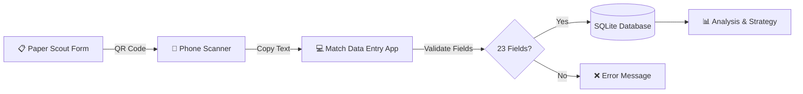

# FRC Team 1730 Scouting Database Tools

A Python-based scouting data management system built for FRC Team 1730's 2024–2025 REEFSCAPE season. This project served as the bridge between QR-code-based scouting and SQL database storage during Aamir Abatiyow's senior year.

## Overview

At FRC competitions, scouts record match and pit data on paper forms that encode information into QR codes. This application provides a streamlined workflow for scanning those QR codes, validating the data, and storing it in a SQLite database for analysis.

### Key Features

- **Match Data Entry** (`GKC/match_data_entry.py`) — CustomTkinter GUI for importing match scouting data
- **Pit Data Entry** (`GKC/pit_data_entry`) — GUI for importing pit scouting information
- **Statbotics Integration** (`statbotics_db.py`) — Fetches public team statistics from the Statbotics API
- **Legacy Tools** (`old/`) — Earlier iterations of the scouting apps and data viewers

## How It Worked at Events



1. **Scout fills out paper form** — Records match observations (scoring, defense, breakdowns, comments)
2. **QR code scanned** — The form's QR code encodes all fields separated by `*` delimiters
3. **Paste into app** — Scout pastes the QR string into the text entry box
4. **Validation** — App splits on `*`, checks for exactly 23 fields (match) or 39 fields (pit)
5. **Database insert** — Valid data is inserted into SQLite with auto-incrementing ID
6. **Strategy meetings** — Team uses the collected data for alliance selection and match strategy

## Database Schema

### MATCH_SCOUTING Table

| Column | Type | Description |
|--------|------|-------------|
| ID | INTEGER | Primary key (auto-increment) |
| Match | INTEGER | Match number |
| Team | INTEGER | Team number being scouted |
| Preload | TEXT | Whether robot had preloaded game piece |
| Station | TEXT | Driver station position (e.g., "Blue 1") |
| Position | TEXT | Starting position on field |
| Leave | TEXT | Whether robot left starting zone |
| Auto | TEXT | Autonomous scoring summary |
| Died / Broke | TEXT | Robot failure indicators |
| PlayedDefense / FacedDefense | TEXT | Defense interactions |
| L4, L3, L2, Trough, Processor, Net | INTEGER | Scoring counts by location |
| TakenOff, Missed | INTEGER | Pickup and miss counts |
| Barge | TEXT | Barge/climb level achieved |
| Comments | TEXT | Free-text scout observations |
| Cycles | INTEGER | Total scoring cycles |
| Name | TEXT | Scout's name |

### PIT_SCOUTING Table

Captures robot specifications, capabilities, and drive team information collected in the pit area. Includes drivetrain type, mechanisms, autonomous capabilities, and strategic strengths.

## Statbotics Integration

The `statbotics_db.py` script fetches publicly available team statistics from the [Statbotics API](https://www.statbotics.io/) and stores them in `team_stats.db`. This includes EPA (Expected Points Added) breakdowns, win/loss records, and ranking data.

## Running with Sample Data

### Prerequisites

```bash
pip install customtkinter
```

### Quick Start

1. **Copy sample database to working directory:**
   ```bash
   cp sample_data/scouting_database.db ./scouting_database.db
   ```

2. **Run the match data entry app:**
   ```bash
   cd GKC
   python match_data_entry.py
   ```

3. **Test with sample QR data** (paste this into the entry box):
   ```
   3*99905*Yes*Blue 1*Center*Yes*A4-B3*No*No*No*No*2*3*1*0*1*0*0*1*BargeLevel.deep*Test comment*6*Demo
   ```

The app validates field count, checks numeric fields, and inserts into the database.

## Project Structure

```
.
├── GKC/
│   ├── match_data_entry.py    # Main match scouting intake app
│   └── pit_data_entry         # Pit scouting intake app
├── old/                        # Legacy tools and viewers
│   ├── create_database.py     # Database schema setup
│   ├── tabview.py             # Data viewer with filtering
│   ├── pit_table.py           # Pit data viewer
│   └── ...
├── sample_data/
│   └── scouting_database.db   # Demo database with fake data
├── statbotics_db.py           # Statbotics API integration
├── team_stats.db              # Public Statbotics data
└── README.md
```

## Organization

This repository is part of [aamir-frc-scouting](https://github.com/aamir-frc-scouting), a collection of FRC scouting and data tools.

---

## History Note

This repository's git history was rewritten in November 2026 to remove sensitive real scouting data (including free-text scout comments about other teams) before the repository was made public. Original commit dates and messages were preserved; commits that only touched data files remain as empty commits.

The `team_stats.db` file and `statbotics_db.py` script were **not** scrubbed—they contain only publicly available statistics from the Statbotics API.

---

## Fun Fact 🏆

The team used the Statbotics data (`team_stats.db`) to run a fantasy FRC tournament at the hotel during the World Championship—because when you're surrounded by robots all day, why not draft some imaginary ones at night?
